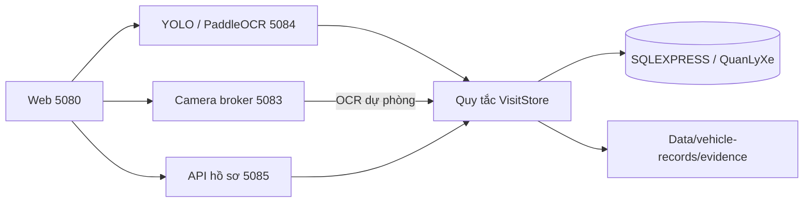

# Backend và SQL Server

ASP.NET Core phục vụ HTML/CSS/JS tại 5080 và khởi động worker. Python broker
5083 giữ bốn RTSP riêng trong RAM; Python OCR 5084 chạy YOLO → PaddleOCR rồi
ghi hồ sơ. Python API 5085 đọc/lọc hồ sơ/ảnh, nhập/sửa có audit, đính kèm ảnh,
xóa có khôi phục và xác nhận ra thủ công.



## Phân chia mã

- `tools/vehicle_records.py`: quy tắc xe vào/chờ/ra, suppression, ảnh và audit.
- `tools/sqlserver_store.py`: connection Windows Authentication, transaction,
  khóa ứng dụng, chuyển các cú pháp SQLite giới hạn sang T-SQL. Dùng lại các
  phương thức nghiệp vụ, không sao chép một bộ quy tắc khác cho SQL Server.
- `tools/record_storage.py`: chọn nguồn duy nhất cho cả OCR và API.
- `tools/sqlserver_schema.sql`: cấu trúc 6 với tên bảng/cột tiếng Việt không dấu.
- `tools/sqlserver_vietnamese.py`: ánh xạ tên SQL, giữ nguyên API và giá trị.
- `tools/localize_sqlserver.py`: nâng cấp tên trực tiếp từ cấu trúc 5 sang 6,
  backup và đối chiếu trước khi hoàn tất, rollback toàn bộ nếu lỗi.
- `tools/sqlserver_management_v7.sql`, `tools/upgrade_records_v7.py`: cấu trúc
  7 cho ghi chú, đánh dấu kiểm tra, phiên bản sửa, lịch sử sửa và ảnh bổ sung;
  backup/đối chiếu trước nâng cấp. `setup_sqlserver.py` tạo mới đến cấu trúc 7.
- `tools/setup_sqlserver.py`: tạo DB, backup, chuyển dữ liệu và đối chiếu.
- `Data/database.json`: cấu hình đang dùng. Không có mật khẩu; không lưu RTSP.

## Các bảng trong QuanLyXe

| Bảng | Nội dung |
| --- | --- |
| dbo.LuotXeRaVao | Một lượt xe: biển số, cổng/giờ vào–ra, trạng thái, Thùng rác |
| dbo.LanGhiNhanCamera | Lần nhận diện vào/chờ/ra, tên hai ảnh, SHA-256, độ tin cậy |
| dbo.TrangThaiKhuD | Phiên bản trạng thái D |
| dbo.ChongGhiTrungBienSo | Chống ghi lượt mới khi biển vừa ra vẫn nằm trong ảnh |
| dbo.DieuChinhLuotXe | Xác nhận thủ công: cổng, giờ, lý do, lúc xác nhận |
| dbo.PhienBanCauTruc | Phiên bản cấu trúc database |
| dbo.NhatKyChuyenDuLieu | Nhật ký chuyển dữ liệu và đường dẫn backup |
| dbo.NhatKySuaHoSo | Lý do nhập/sửa, dữ liệu trước/sau, thời điểm |
| dbo.AnhBoSungHoSo | Ảnh do người vận hành đính kèm, vai trò vào/ra, SHA-256 |

ID và liên kết hồ sơ được giữ nguyên. Giờ lưu `datetimeoffset(3)` UTC,
API trả ISO-8601 như trước; web hiển thị UTC+7. Nội dung tiếng Việt dùng
nvarchar. Ảnh vẫn nằm trong thư mục evidence; database lưu tên ảnh và checksum.

Tên bảng/cột dùng tiếng Việt không dấu (ví dụ `BienSo`, `CongVao`,
`CongRa`, `ThoiGianVao`, `ThoiGianRa`, `TrangThai`) để gõ truy vấn thuận tiện.
Các khóa, ràng buộc và index của ứng dụng cũng có tên tiếng Việt. Dữ liệu giữ
nguyên: `INSIDE`, `COMPLETE`, `WAITING`, `real`, `entry`, `exit` không bị dịch.
Lớp ánh xạ chỉ đổi identifier SQL; chuỗi literal, tham số ODBC, JSON/API và
biến Python/JavaScript vẫn giữ giao ước cũ. `dbo`, kiểu dữ liệu, bảng hệ thống
và các nhãn Tables/Keys/Indexes do SQL Server/SSMS quản lý không đổi.

Bản đồ toàn bộ tên cũ/mới nằm trong `tools/sqlserver_vietnamese.py`.

## Tính nhất quán

Mỗi quyết định ghi lấy khóa SQL Server `sp_getapplock` Exclusive theo
transaction. Đọc bảng/revision/D dùng khóa Shared cùng resource để không
trộn các trạng thái giữa hai lần ghi. Khóa dùng chung giữa mọi process,
được nhả khi commit, rollback hoặc mất kết nối.
[Tài liệu Microsoft](https://learn.microsoft.com/en-us/sql/relational-databases/system-stored-procedures/sp-getapplock-transact-sql?view=sql-server-ver17).

SQL Server không kết nối được thì trả lỗi và D chưa xác định giữ đỏ;
không âm thầm ghi SQLite để tránh tách dữ liệu. Quy tắc camera đầu tiên
vào, camera khác cùng biển ra được giữ nguyên. Cổng phân biệt bằng camera_id;
không chặn cổng ra chỉ vì hai ô được nhập cùng URL RTSP riêng.

## Cấu hình và sao lưu

Ứng dụng dùng `Data/database.json`, xem mẫu `config/database.example.json`.
Windows Authentication chạy theo tài khoản của process. Encrypt luôn Yes.
TrustServerCertificate chỉ được chấp nhận cho SQL Server trên máy cục bộ;
không cài chứng chỉ hay thay thiết lập bảo mật Windows. Máy chủ từ xa phải
dùng chứng chỉ hợp lệ và để tùy chọn này false.

Khi chuyển dữ liệu phải dừng 5083/5084/5085 trước, tránh ghi đồng thời vào
hai nơi. Công cụ tạo backup SQLite bằng backup API (gồm WAL đã commit), sao
lưu ảnh được tham chiếu, kiểm tra checksum, rồi ghi SQL trong một transaction.
Đối chiếu tất cả bảng và từng cột trước khi đổi cấu hình. Không xóa source.
Backup và báo cáo nằm trong `Data/backups/sqlserver-<ngày giờ>-<id>/`.

Khi vận hành lâu dài cần backup SQL Server và thư mục evidence cùng nhau;
backup SQLite lúc chuyển đổi không chứa những lượt mới ghi sau đó.

Lệnh `python tools/localize_sqlserver.py` chỉ in tên dự kiến. Thêm `--apply`
mới thực hiện nâng cấp 5 → 6 và yêu cầu dừng ba worker trước. Công cụ tạo
backup SQL Server `COPY_ONLY, CHECKSUM`, kiểm tra bằng `RESTORE VERIFYONLY`,
lưu bản JSON và bản sao ảnh có đối chiếu SHA-256 trong
`Data/backups/viet-hoa-<ngày giờ>-<id>/`. File `.bak` nằm tại thư mục backup
mặc định của dịch vụ SQL Server; đường dẫn chính xác được ghi trong
`kiem-tra.json`. Không thay quyền Windows để đọc thư mục này.

Đổi tên bằng `sp_rename` giữ nguyên object ID, ID hồ sơ, liên kết và giá trị;
thêm bản ghi phiên bản 6. Các SELECT/UPDATE của backend được ánh xạ đồng thời.
Ràng buộc CHECK(Ma=1) được tạo lại tương đương trong cùng transaction để SQL
Server cho đổi tên cột; khóa chính/ngoại và index được giữ, chỉ đổi tên.
Nếu đối chiếu khác nội dung hoặc có view/procedure/trigger phụ thuộc chưa
được xử lý, công cụ rollback thay vì tiếp tục.
[Quy tắc sp_rename của Microsoft](https://learn.microsoft.com/en-us/sql/relational-databases/system-stored-procedures/sp-rename-transact-sql?view=sql-server-ver17).

## Kiểm tra bằng SSMS

Kết nối `.\SQLEXPRESS` bằng Windows Authentication. Mở database `QuanLyXe`,
hoặc chạy các SELECT chỉ đọc bên dưới:

```sql
USE QuanLyXe;
SELECT DB_NAME() AS DatabaseDangDung;
SELECT TOP (50) BienSo, CongVao, ThoiGianVao, CongRa, ThoiGianRa,
       TrangThai, ThoiGianXoa FROM dbo.LuotXeRaVao
ORDER BY COALESCE(ThoiGianRa, ThoiGianVao, ThoiGianTao) DESC;
SELECT TOP (50) * FROM dbo.LanGhiNhanCamera ORDER BY ThoiGianGhiNhan DESC;
SELECT * FROM dbo.TrangThaiKhuD;
SELECT * FROM dbo.NhatKyChuyenDuLieu ORDER BY ThoiGianHoanThanh DESC;
```

File truy vấn đầy đủ: `docs/QUAN_LY_XE_KIEM_TRA.sql`. Sau khi nâng cấp,
nhấp phải **Tables → Refresh** trong SSMS để cập nhật danh sách tên.

## Kiểm thử

Unit/adapter/OCR dùng SQLite tạm khi đặt `CAMERA_RECORDS_BACKEND=sqlite`.
Bộ SQL integration đặt thêm `CAMERA_SQLSERVER_TESTS=1`; nó tự tạo DB riêng
`QuanLyXe_Test_<UUID>` và chỉ dọn đúng DB tạm đó. Không dùng hồ sơ thật để
thử sự kiện vào/ra. Không để biến override SQLite trong môi trường vận hành.
Kiểm thử nâng cấp có backup bằng SQL Server trong thư mục backup mặc định;
các file mang tên `QuanLyXe_Test_<UUID>_TruocVietHoa_...bak` là backup của
DB kiểm thử đã được dọn, không phải hồ sơ vận hành.
